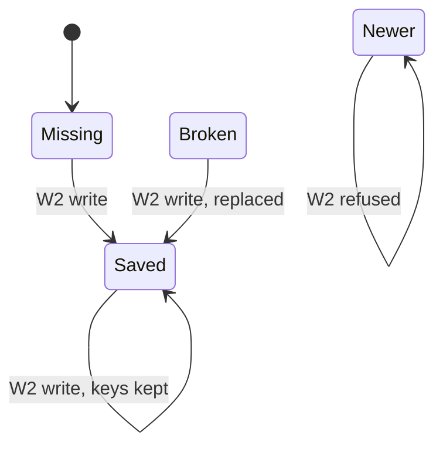
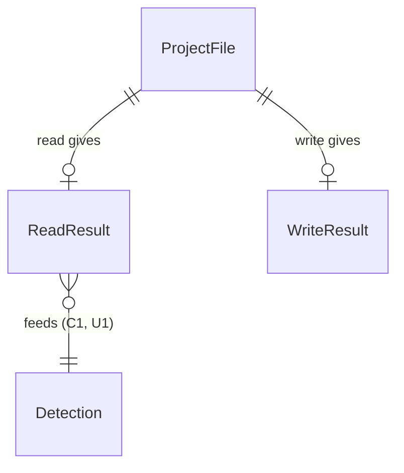

# Functional Spec: u2-framework-file (US1.2, US-1408)

Implements US1.2 from `stories.md` (AC1.2.1–AC1.2.3). Sources: `unit-of-work.md` (U2, a library Unit), `unit-of-work-story-map.md`, `requirements.md` (FR2), `contract-summary.md` (C1, C2). Data shape is in `entities.md`, decision logic in `rules.md`. Both win over this file where they disagree.

## What this Unit gives

- **Read** the project file, giving a ReadResult (BR1.1, BR1.2).
- **Saved framework for detection:** the open path and the re-detect path both pass the saved value, or the reason it can't be used, into U1's detection (BR1.3–BR1.5). Today both call detection with no saved value.
- **Write** a confirmed choice, giving a WriteResult (BR2.1–BR2.6). U4 (first open) and U8 (switch) call it after their preview, which names `.thadeus/project.json` (AC1.2.2). U2 has no screen and no IPC channel of its own.

## Workflows

**W1 Open or re-detect a project**
1. Read the file (BR1.2).
2. Not ok and not missing: detect with no saved value, and set the reason from the read (BR1.3).
3. Ok, but the framework's folder is not in the project: detect with no saved value, and set the reason "saved framework not found" (BR1.4).
4. Ok and found: the detection takes the saved framework, `source: file`, and nothing is asked (BR1.5).
5. The detection push (C1) carries the result. Nothing is written in any step.

**W2 Write a confirmed choice**
1. Check the framework is aidlc or speckit, otherwise `invalidFramework` (BR2.2).
2. Read the existing file (BR1.2).
3. `unknownVersion`: refuse with `newerVersion` (BR2.5).
4. `unreadable` or `invalid`: build a fresh file and mark `replaced` (BR2.4).
5. Otherwise, a missing file starts empty and a readable one keeps its keys; set `version: 1` and the framework (BR2.3).
6. Write atomically (BR2.6). The result names the file.

## States

The file has no lifecycle of its own. For one project it is in one of these states, and only W2 moves it:

`Broken` covers unreadable and invalid. `Saved` covers ok and unknownFramework.

## Entity view (derived from entities.md)

## Rules summary (derived from rules.md)

Read: BR1.1 fixed path, BR1.2 five reasons, BR1.3 fall back and say why, BR1.4 saved framework not found, BR1.5 follow without asking. Write: BR2.1 only when confirmed, BR2.2 two values, BR2.3 keys kept, BR2.4 broken file replaced, BR2.5 newer refused, BR2.6 atomic.

## Error handling

- Every read failure becomes a reason in the detection, never a thrown error, so the project still opens.
- A write failure returns `{ ok: false, error: { code, message } }` (the IPC convention in `contract-summary.md`), and the old file stays.
- Texts go through `t()` in `sv`/`en` (NFR1). The file lives under `.thadeus/`, never in `.specify/` or `specs/` (NFR3).
