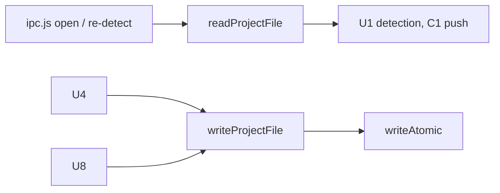

# Logical Components: u2-framework-file (US-1408)

Sources: `security-requirements.md`, `tech-stack-decisions.md`, `functional-spec.md`, `contract-summary.md` (C1, C2).

| Component | Where | Does | Failure domain |
|---|---|---|---|
| projectFile | `src/main/projectFile.js` (new) | `readProjectFile`, `writeProjectFile` (see `security-design.md`) | One project. A failure gives a reason or an error result, never a throw to the caller. |
| writeAtomic | `src/main/fileWrite.js` (existing) | Temp file plus rename, with the `expect` recheck | The one file. On failure the old file stays. |
| Detection | U1, through `ipc.js` | Takes the read result on open and re-detect (W1, BR1.3–BR1.5) | A bad file only adds a reason to the C1 push; the project still opens. |
| Callers of the write | U4 (first open), U8 (switch) | Call `writeProjectFile` after a confirmed preview (BR2.1) | A refused write leaves the views as they were. |

Shared resource: the one file `.thadeus/project.json`, committed to git (C2). Two clones that save different frameworks give a git conflict, which git shows. No lock is held across processes. Two app windows on the same project are not guarded: the second write wins atomically.
