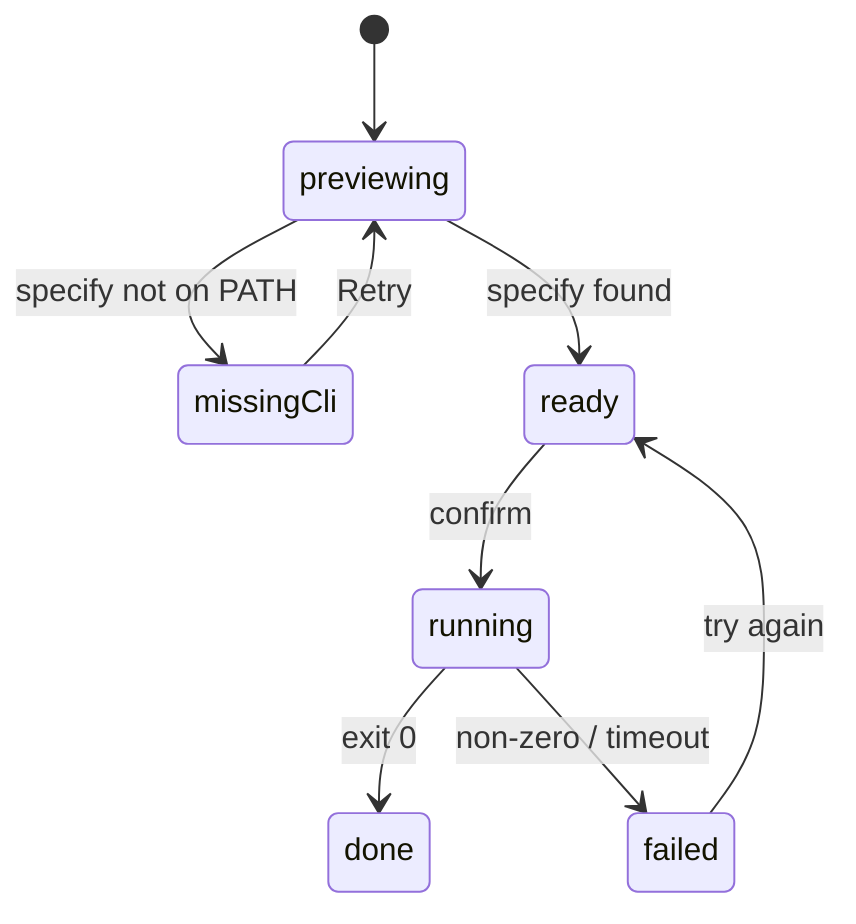

# Functional Spec: U3 u3-speckit-setup (US2.1 / US-1405)

This spec implements US2.1 in `stories.md` (AC2.1.1–AC2.1.4), together with FR3, NFR3, NFR4 and contract C3. The rules are in `rules.md` (BR3.1–BR3.9). It mirrors the AI-DLC setup (`src/main/setup.js`, `setup:info` and `setup:run` in `ipc.js`) and reuses its pattern: preview first, fixed arguments, one run per root.

## Workflow: set up Spec Kit

1. The person opens the setup view, which today is the view for a project with no framework. Next to the AI-DLC setup there is now a choice: "Set up Spec Kit".
2. The renderer calls `speckit:setupPreview(projectId)`, which applies BR3.1. It returns `{ specifyOnPath, version, installHint, harnesses, command }`.
3. If `specifyOnPath` is false, the view shows the hint `uv tool install specify-cli` (BR3.6) and a Retry button that runs step 2 again. The flow stops there.
4. If the project has exactly one harness, it is chosen. If it has none or two, the person picks Claude Code or opencode (BR3.2). The view shows the exact command it will run (BR3.4).
5. The person confirms, and the renderer calls `speckit:setup(projectId, harness)`, which checks BR3.2 and BR3.3 and then runs the command.
6. **Success:** the output is shown, and U1's setup watcher re-detects the project and switches it to the Spec Kit views (BR3.8).
7. **Failure or timeout:** the output and the reason are shown, and the project stays as it was in the app (BR3.5).

Text fallback: the flow starts at the preview. If `specify` is missing, it shows the hint and waits for Retry. Once `specify` is found, confirming runs the setup, which ends in done or failed. From failed, the person can try again.

## Main-side module

`src/main/speckitSetup.js` exports `getSpeckitSetupInfo(root, { exec })` and `runSpeckitSetup(root, { harness }, info, { exec })`. Both use `runFixed` and the `toolPath('specify')` lookup in the same way `setup.js` uses `toolPath('aidlc')`. IPC registers `speckit:setupPreview` and `speckit:setup`, and the preload exposes both.

## Settled after the design review, checked against specify 1.4.3

- **Preview per harness (R-01).** The preview is `speckit:setupPreview(projectId, harness)`. When the project has one harness, that harness is the default; otherwise the person's pick is used. The preview stores `harness`, and `speckit:setup` refuses a harness that differs from it (BR3.3).
- **Existing project (R-02).** `specify init --here` stops to ask when the folder is not empty. The command is therefore `specify init --here --force --non-interactive --integration <harness>`. Before the person confirms, the preview lists what will be added: `.specify/` and the harness's command or skill folder. When the folder already has files, the preview says so: "existing files stay; Spec Kit adds its own". U3 never runs `git init`.
- **Tool path (R-03).** `specify` is added to `TOOL_IDS` in `src/main/tools.js`, so a saved tool path is honoured, the same way `aidlc` works.

## Assumptions

- The flag form `--here --integration <claude|opencode>` follows the epic. It is confirmed on the Spec Kit test project before U6, and changing it touches only BR3.4's argument list.
- The `specify` timeout is 120 s, the same as the AI-DLC setup step timeout (`STEP_TIMEOUT_MS`).

## Tests (written first)

- **Preview:** `specify` missing gives the hint and no throw; `specify` found gives its version; harness detection covers none, claude, opencode and both.
- **Run:**
  - refuses an unknown harness, a missing preview, a preview for another harness, and a second run in parallel;
  - success returns ok with the output;
  - a non-zero exit returns `failed` with the output;
  - a timeout returns `timeout`.
- **Read-only:** no fs write by U3 code under `.specify/` or `specs/`, checked with a write spy (BR3.7).
- **Renderer:** missing-CLI hint and Retry, the harness picker when there are 0 or 2 harnesses, the command shown before confirm, and the output shown on success and on failure.
