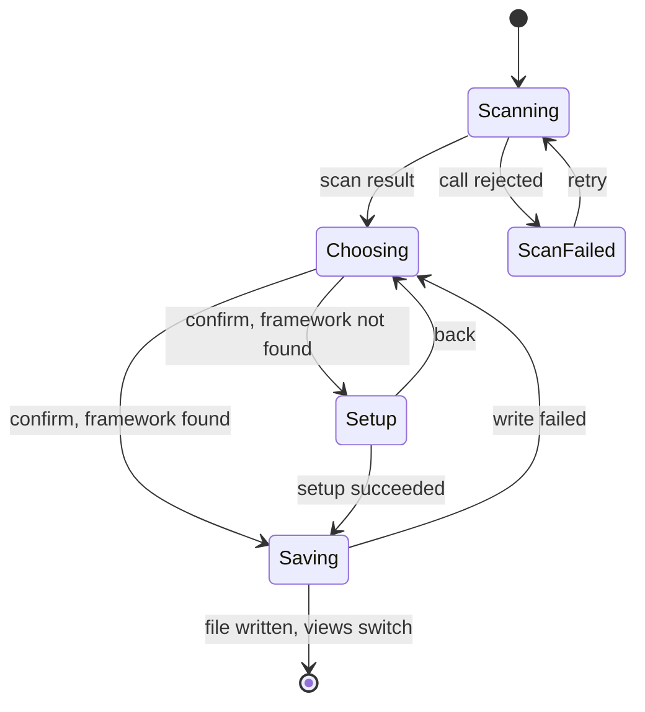

# Functional Spec: U4 u4-framework-choice (US2.2 / US-1406)

This spec implements US2.2 in `stories.md` (AC2.2.1–AC2.2.3), assigned to U4 in `unit-of-work-story-map.md` and described in `unit-of-work.md`. It covers FR4 in `requirements.md` and provides contract C4 in `contract-summary.md`, using C1 (detection), C2 (`.thadeus/project.json` through U2) and C3 (U3's Spec Kit setup). The rules are in `rules.md` (BR4.1–BR4.8). Domain Design was skipped, so the boundaries follow the code.

## What the code already settles

- `detectProject` (U1) already has the `source: ask` case, switched off (`askWhenBoth`). U4 switches it on for every project with no saved file (BR4.1).
- U2 writes `.thadeus/project.json` atomically; U3 (`feat/US-1405`, not yet on `main`) adds `SetupSpeckit` and a simple AI-DLC / Spec Kit choice above the setup panels. U4 replaces that choice with the full screen. **U4 builds after U3 is merged.**

## Contract C4, with Q2's change

```yaml
project:frameworkScan(projectId) -> { found: { aidlc: boolean, speckit: boolean }, cli: { aidlc: boolean, specify: boolean }, proposal: aidlc | speckit | null }
project:chooseFramework(projectId, framework) -> { ok: true, file: ".thadeus/project.json" | null, next: setupAidlc | setupSpeckit | none }
```

`file` is null when nothing was written: the chosen framework was not found and its setup comes first (BR4.6). This is an additive change to C4, which U4 owns.

## Workflow: first open

1. Detection finds no `.thadeus/project.json` and pushes `framework: null, source: ask` (BR4.1).
2. The project view shows `FrameworkChoice`, which calls `frameworkScan` (BR4.2, BR4.3).
3. The screen lists AI-DLC and Spec Kit, each as found or not, with its tool on the PATH or not. A proposal is preselected (BR4.4).
4. The person confirms a framework. `chooseFramework` runs (BR4.8):
   - found: it writes the file through U2 and returns `next: none`; the C1 push switches the views (BR4.5);
   - not found: nothing is written; the screen shows that framework's setup panel (BR4.6).
5. After a successful setup, the screen calls `chooseFramework` again, which now writes. A failed or closed setup writes nothing.

Screen states:



Text fallback: the screen scans, then waits for a choice. A found framework is saved at once; one that is missing goes through its setup and is saved when the setup succeeds. A failed scan or write shows its reason and lets the person try again.

## Main-side modules

- `projectService.js`: `detectProject` asks when the file is missing (`read.reason === 'missing'`); other read failures keep U2's fallback and reason.
- `frameworkChoice.js` (new): `frameworkScan(root)` and `chooseFramework(root, framework)`, read-only except U2's write.
- `ipc.js`: the two handlers, through `project(projectId)`.

## Assumptions

- "No saved choice" means the file is missing. An unreadable or invalid file keeps U2's behaviour (detection with its reason), so U2's message is not hidden.
- Existing AI-DLC projects without the file see the screen once after the update, AI-DLC proposed (Q1 = A).

## Tests (written first)

- **Detection:** no file with one, both or neither found gives `ask`; a valid file is followed; an invalid file keeps its reason.
- **Scan:** found and cli for each case; a failing tool lookup counts as not found; the proposal for one, both and neither; no write.
- **Choose:** found writes and returns `none`; not found writes nothing and returns the setup; an unknown framework or project rejects; a write failure rejects with its reason.
- **Renderer:** each state; the proposal preselected and one click confirms; both found with no proposal; the setup panel for a missing framework; save after setup success; nothing saved after a failed or closed setup; texts through `t()`.
