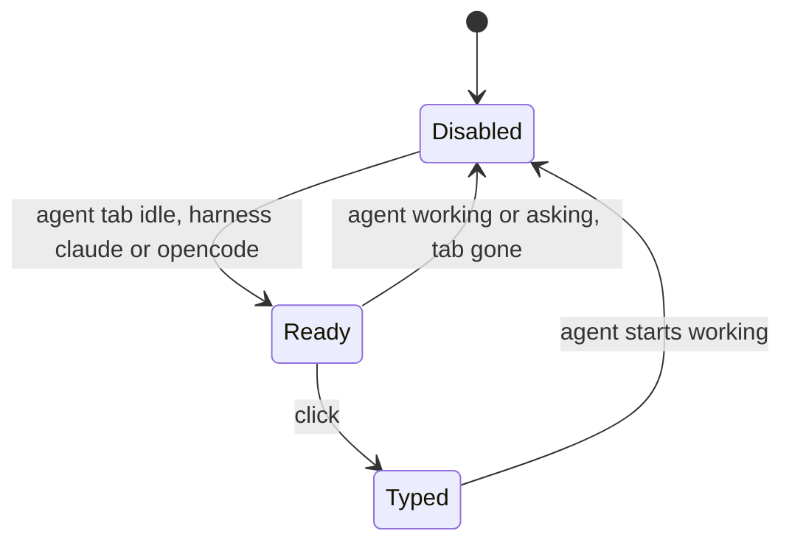

# Functional Spec: U5 u5-speckit-commands

U5 implements story US3.1 (US-1403) from `stories.md`. Sources:
- `unit-of-work.md` and `unit-of-work-story-map.md` (U5);
- `requirements.md` FR5 and FR6.2;
- `contract-summary.md` C5, C6 and C7.

Domain Design was skipped, so the parts come from the code: U6's features view, U7's rules view, and the terminal control (`TerminalContext.jsx`). The rules are in `rules.md`. U5 reads nothing new from disk and writes nothing; it only types into the agent tab.

## The command form (O1, settled)

The installed Spec Kit 1.4.3 settles contract C7's open question:
- **Claude Code** gets skills under `.claude/skills/speckit-<name>/`, invoked as `/speckit-plan`. An extension command `speckit.git.commit` becomes `/speckit-git-commit`.
- **opencode** gets commands under `.opencode/commands/speckit.<name>.md`, invoked as `/speckit.plan`.

This comes from the tool's code, not yet from a run on the test project. The manual release check confirms it in both harnesses. `speckitCommand` (BR5.1) is the only place that knows it.

## Workflows

**W1: Run the next command (AC3.1.1)**
1. The person opens a feature in the Spec Kit view.
2. IF the feature is not active, the detail says the commands act on the active feature, by name (BR5.4). Stop.
3. `nextCommand(feature)` gives the stem (BR5.2, BR5.3), and `speckitCommand` gives the text (BR5.1).
4. The button shows the text. IF it cannot run, it is disabled and says why (BR5.8).
5. A click types the text and Enter into the agent tab (BR5.7). The terminal shows.
6. When the files change, `speckit:changed` refreshes the feature, and step 3 runs again.

**W2: A quick command (AC3.1.2)**
1. The quick bar shows specify, clarify, analyze and constitution, then each extension's commands (BR5.5).
2. For specify, the person types a description; the button stays disabled until it is valid (BR5.6).
3. A click runs it as in W1 steps 4–5. Specify sends the description as its argument, and clears the field after it was typed.

**W3: Cannot run (AC3.1.4)**
Each button is disabled with its reason while there is no agent tab, the harness is not known yet, the harness is not supported, or an agent is working or waiting on a question (BR5.8). Nothing is queued for later.

## States of a command button

<!-- Text fallback: a button starts disabled, becomes ready when an idle agent tab runs claude or opencode, goes back to disabled when the agent works, asks or its tab goes, and a click types the command, after which the agent works and the button is disabled. -->

## Rules summary

Derived from `rules.md`:
- the form follows the tab's harness (BR5.1);
- the next command follows the flow (BR5.2), and converge stays after converge (BR5.3);
- only for the active feature (BR5.4);
- the core four plus extension commands (BR5.5);
- the description is one plain line (BR5.6);
- only a click types, with Enter (BR5.7), and a button that cannot run says why (BR5.8);
- the two hard-coded strings go (BR5.9).

## Edge cases

- The agent tab runs a harness that Spec Kit was not set up for: the command is still typed in that harness's form, and the agent answers that it does not know it. `ponytail:` the tab's harness is trusted, not the project's Spec Kit files; check the installed command files if this confuses people.
- Two agent tabs: the command goes to the last agent tab used, in its form, as the other quick commands do.
- An extension command name that is not safe is already left out by U7's reader (C6).
- No `specs/` features: U6's empty state offers specify through the same quick bar.
