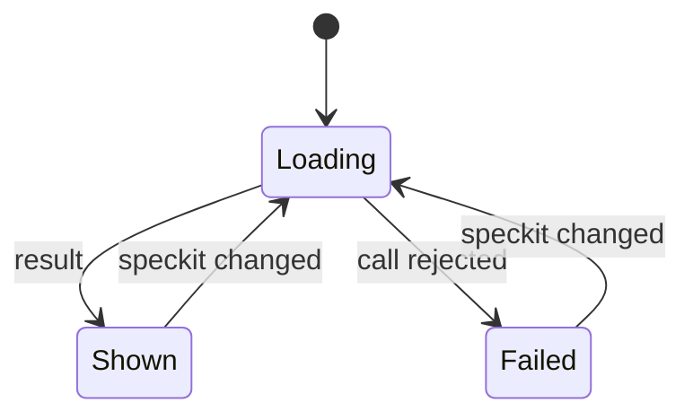

# Functional Spec: U7 u7-constitution (US4.2 / US-1404)

This spec implements US4.2 in `stories.md` (AC4.2.1–AC4.2.3), assigned to U7 in `unit-of-work-story-map.md` and described in `unit-of-work.md`. It covers FR7 and NFR3 in `requirements.md`, feeds FR5.2 (U5's quick commands), and provides contract C6 (`speckit:rules`) in `contract-summary.md`. The rules are in `rules.md` (BR7.1–BR7.9). Domain Design was skipped, so the boundaries follow the code.

## What the installed Spec Kit settles

The Spec Kit 1.4.x tool on this machine shows:
- `.specify/extensions.yml` holds `installed`, `settings` and `hooks`. `hooks` maps an event (`before_specify`, `after_implement`, ...) to a list of entries `{ extension, command, enabled, optional, priority, prompt, description, condition }`. `enabled` and `optional` default to true.
- An extension's commands are not in that file. They are in `.specify/extensions/<id>/extension.yml` under `provides.commands` (Q2 = A).
- The editor already saves the constitution and keeps every other Spec Kit file read-only (U6).

## Contract change (additive)

C6's hook gets `target`, the command it runs before or after (AC4.2.2). U7 owns C6, so this is changed in U7's pull request, and the change is additive:

```yaml
hooks: [ { when: before | after, target: string, command: string, mode: optional | mandatory | off } ]
skipped: int          # hook entries that could not be read (BR7.4)
```

## Workflow: show the rules

1. In a Spec Kit project, Configuration shows a Spec Kit section (BR7.9, Q1 = A). Opening it mounts `SpeckitRules`, which calls `speckit:rules(projectId)`.
2. The main side checks the constitution (BR7.1) and reads `extensions.yml` (BR7.3).
3. It builds the hooks (BR7.4, BR7.5) and the extension list, reading each extension's manifest for its commands (BR7.6).
4. It returns the C6 shape. Every failed read goes in `errors`. Nothing is written (BR7.7).
5. The view shows the constitution rendered with an Open in editor button (BR7.2), or the no-constitution text with a `/speckit-constitution` button; then each extension with its commands and hooks (when, target, command, mode); then the errors.
6. A change to a watched file pushes `speckit:changed` (BR7.8) and the view calls step 1 again.

Screen states:



Text fallback: the view loads, then shows the result or the failure; a Spec Kit file change loads it again.

## Main-side modules

- `src/main/speckitRules.js`: `loadSpeckitRules(root)` gives the C6 result; `hooksFrom(config)` is a pure function for BR7.4 and BR7.5, so most tests need no files.
- `speckitWatchPaths` (U6) adds the three paths of BR7.8.
- `ipc.js` registers `speckit:rules` for a project whose framework is `speckit`; the preload exposes `speckitRules(projectId)`.
- `package.json` adds `yaml` (FR7.2).
- `frameworkViews.js`: `sectionsFor('speckit')` gives `['docs', 'agent', 'speckit']`.

## Assumptions

- A hook's `condition` is not evaluated, as Spec Kit's own commands leave it to Spec Kit. It is shown as a short note when set.
- Commands show as Spec Kit names them (`speckit.git.commit`). The form that runs in the terminal is U5's (C7).

## Tests (written first)

- **Hooks:** before and after keys, a single mapping and a list, an entry without command and a non-matching key skipped and counted, each mode from `enabled`/`optional` with their defaults.
- **Rules reader:** constitution present, missing and unreadable; `extensions.yml` missing, invalid YAML, a list root; `installed` as strings and as mappings; an id only in a hook; a manifest present, missing, invalid, and an unsafe id; the errors list while the rest shows.
- **Read-only:** the reader run on a fixture with a write spy; no write under `.specify/` (BR7.7).
- **Watcher:** a change to `extensions.yml` and to the constitution pushes `speckit:changed` within 2 s.
- **Renderer:** the Spec Kit section only for a Spec Kit project; constitution rendered, Open in editor, the no-constitution button; extensions with commands and hooks; the skipped count; the parse-failure note; the errors; a refresh on `speckit:changed`.
