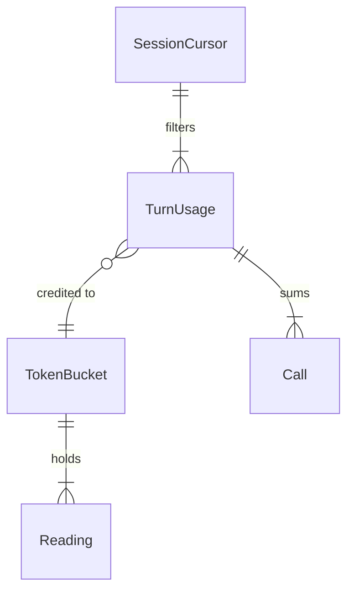

# Functional Spec — u9-feature-token-log

Implements US5.1 (US-1409) from `stories.md`: AC5.1.1–AC5.1.3, FR9.1–FR9.3 in `requirements.md`. Unit U9 in
`unit-of-work.md` and `unit-of-work-story-map.md`; contract C8 (and the C5 feature reader) in `contract-summary.md`.
Kind: library (main process). No UI in this story (Q3): the files are read by a later story's view.

## Workflow W1: credit one agent turn

1. An agent turn ends: a Claude Code Stop event (with its transcript path) or an opencode usage event arrives through
   the existing hook channel.
2. If the project's framework is not Spec Kit, stop (BR1.1).
3. Build the turn's usage from the session's calls the cursor has not counted (BR1.2 Claude, BR1.3 opencode). No new
   calls: stop.
4. Resolve the active feature now, at turn end, with the C5 reader (BR1.4, BR2.1). Valid folder: bucket
   `speckit-<folder>`; anything else: `speckit-project`.
5. Price the calls (BR4.1), add them to the bucket's last reading, append or replace (BR2.2).
6. Write the bucket atomically under `.thadeus/tokens/` (BR3.1).
7. Only after the write succeeds, advance the session cursor (BR3.2). A failure is logged; step 3 of the next turn
   picks the same calls up again.

Turns of one project are handled one at a time (a queue per project), so two sessions cannot race on a bucket file.

## State: session cursor

`unseen` --(first event of the session)--> `counting` --(write ok)--> `counting` (cursor advanced)
`counting` --(write failed)--> `counting` (cursor kept). The cursor lives in the app's user data, per machine, so it
is never committed or merged.

## Edge cases

- App closed during a session: the next turn counts everything since the cursor and credits it to the feature active
  then (BR1.4).
- Turn that creates a feature (`/speckit-specify`): the whole turn goes to the new feature (Q1).
- Model missing from the price table: tokens counted, dollars not (BR4.1).
- A feature folder later deleted: its bucket file stays; new turns go to the project bucket (BR2.1).

## Derived views

<!-- Text fallback: a TokenBucket holds Readings; a SessionCursor filters each TurnUsage; a TurnUsage sums Calls and is credited to one TokenBucket. -->

Rules summary (source `rules.md`): BR1.1 Spec Kit only; BR1.2/BR1.3 count each call once; BR1.4 turn-end feature;
BR2.1 project bucket fallback; BR2.2 no throttle loss; BR3.1 `.thadeus/tokens/speckit-*.json` only; BR3.2 retry on a
failed write; BR4.1 dollars from the price table.

## Assumptions & Open Questions

- [assumption] The opencode plugin's usage event carries the message id and full token counts (input, output,
  cache read/write); its shape is still provisional (K12). Code Generation confirms it from the plugin.
- [assumption] Like the per-intent log, readings from two clones of the same feature are merged by time, not summed;
  a shared per-feature total across machines is out of scope here.
