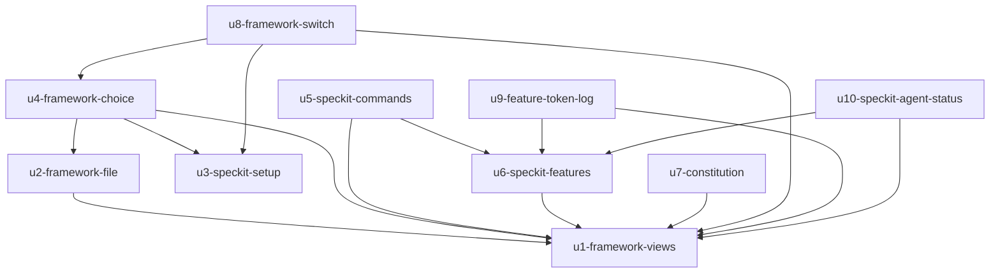

# Unit Dependencies: EPIC-14 Spec Kit

A Unit depends on another when its code or tests need that Unit's code to build or pass. This file describes topology only. Delivery Planning picks the order.

## Edges

- U2 depends on U1: the fallback when the file is missing uses U1's detection.
- U4 depends on U1, U2 and U3: it shows the detection, saves the choice and hands off to setup.
- U5 depends on U1 and U6: the next command comes from the feature status. Extension commands are read from `.specify/extensions.yml` through U7's reader when U7 is present. Until then U5 offers no extension commands, so there is no hard edge.
- U6, U7, U9 and U10 depend on U1, which gives them the Spec Kit view shell and the `framework` value.
- U9 and U10 depend on U6: the active feature and the `tasks.md` counts.
- U8 depends on U1, U3 and U4: the views, the setup and the confirmed-write flow.
- U1 and U3 depend on nothing new. U3 builds on the shipped US-0503 setup.



Text fallback: arrows read "depends on". U1 and U3 are roots.

## Integration points

- **IPC.** Each Unit adds its channels through `ipc.js` and `preload/index.js`. They are additive, and each channel name has one owner.
- **Shared value.** `framework` comes from U1. Its persisted form is U2's `.thadeus/project.json`.
- **Watcher.** U6 adds the `specs/` and `.specify/` paths. U7, U9 and U10 subscribe to them.
- **Terminal.** U5 uses the existing terminal control (Resume and the quick commands).

## Parallel development

Q2 allows parallel building. These sets have no edges between them:
- {U1, U3};
- {U2, U6, U7} once U1 is in;
- {U5, U9, U10} once U6 is in.

Each Unit must pass on its own, with only its dependencies and `main` as it stands.

```yaml
units:
  - name: u1-framework-views
    kind: ui
    depends_on: []
  - name: u2-framework-file
    kind: library
    depends_on: [u1-framework-views]
  - name: u3-speckit-setup
    kind: ui
    depends_on: []
  - name: u4-framework-choice
    kind: ui
    depends_on: [u1-framework-views, u2-framework-file, u3-speckit-setup]
  - name: u5-speckit-commands
    kind: ui
    depends_on: [u1-framework-views, u6-speckit-features]
  - name: u6-speckit-features
    kind: ui
    depends_on: [u1-framework-views]
  - name: u7-constitution
    kind: ui
    depends_on: [u1-framework-views]
  - name: u8-framework-switch
    kind: ui
    depends_on: [u1-framework-views, u3-speckit-setup, u4-framework-choice]
  - name: u9-feature-token-log
    kind: library
    depends_on: [u1-framework-views, u6-speckit-features]
  - name: u10-speckit-agent-status
    kind: ui
    depends_on: [u1-framework-views, u6-speckit-features]
```
