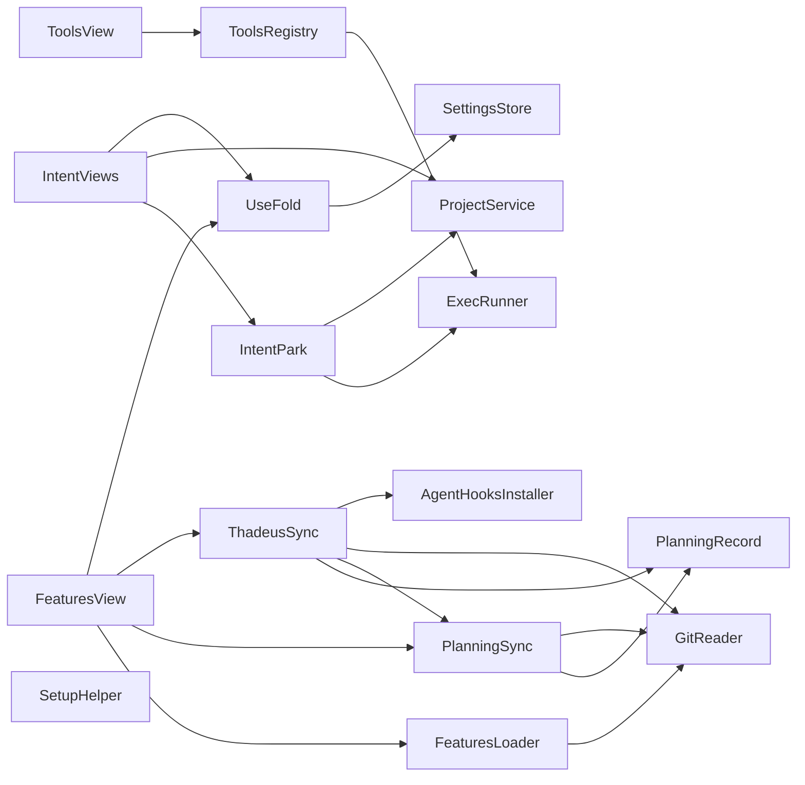

# Components: Release v0.2.13

Five small stories change existing modules; three parts are new: **ThadeusSync** (US-0609), **IntentPark** (US-0510) and **UseFold** (US-0415). Renderer-to-main calls go through the existing preload bridge and IPC router (one named channel each), which are not listed as components. Decisions: `decisions.md` (ADR-001 to ADR-006). Answers: `domain-design-questions.md` [Q1]–[Q9].

```yaml
components:
  - name: ExecRunner
    summary: Runs fixed commands with a timeout and the login shell's PATH (exec.js).
    behaviour: >
      The login shell gets 20 s. A failed or late read falls back to the app's PATH for that call only and is not
      kept; the next lookup reads again. Lookups during a read share that one read (one shell at a time).
      refresh() forces a new read. The result says whether the fallback was used.
    responsibilities: [login-shell PATH read, fixed-command execution with timeouts]
    depends_on: []
    dependents:
      - component: ToolsRegistry
        interaction: PATH for tool lookups, refresh on scan
      - component: IntentPark
        interaction: runs the fixed aidlc park, unpark, intent and status commands
    external_dependencies:
      - name: login shell
        kind: other
        purpose: the PATH the terminal tabs get
    entities:
      - name: LoginPathResult
        identifier: readAt
        attributes: [path, fromFallback]
  - name: ToolsRegistry
    summary: Finds the agent CLIs (tools.js).
    behaviour: >
      A Settings › Tools scan calls ExecRunner.refresh() first. A lookup that used the fallback PATH is reported as such.
    responsibilities: [tool lookup, scan, fallback flag per tool]
    depends_on:
      - component: ExecRunner
        interaction: PATH and refresh
        style: sync
    dependents:
      - component: ToolsView
        interaction: tool rows
    entities: []
  - name: ToolsView
    summary: The Settings › Tools rows.
    behaviour: A row whose tool was found on the fallback PATH says the login shell's PATH could not be read (t(), LCARS).
    responsibilities: [tool rows and their fallback note]
    depends_on:
      - component: ToolsRegistry
        interaction: scan and lookup results over the bridge
        style: sync
    dependents: []
    entities: []
  - name: GitReader
    summary: Fixed git calls (git.js).
    behaviour: Adds a read of one file at a ref (git show <ref>:<path>) and the ref's existence check; no checkout changes.
    responsibilities: [git reads, worktree, fetch, push]
    depends_on: []
    dependents:
      - component: FeaturesLoader
        interaction: planning files at origin/<target>
      - component: PlanningSync
        interaction: fetch, worktree, rebase, push
      - component: ThadeusSync
        interaction: fetch, worktree, rebase, push
    external_dependencies:
      - name: git
        kind: other
        purpose: the repository
    entities: []
  - name: FeaturesLoader
    summary: Loads the overview, epics and release plans (features.js).
    behaviour: >
      When the checkout is not the planning target, reads each planning file from origin/<docs branch or main> through
      GitReader, else the local target before the first fetch or with no remote, and lays the branch's own story blocks
      on top. The result names the branch it came from.
    responsibilities: [planning source choice, overlay of the branch's story blocks, source label]
    depends_on:
      - component: GitReader
        interaction: file at ref
        style: sync
    dependents:
      - component: FeaturesView
        interaction: features and the source branch
    entities:
      - name: PlanningSource
        identifier: ref
        attributes: [ref, kind, fetched]
  - name: PlanningRecord
    summary: The app's record of pending planning and .thadeus changes (planningRecord.js).
    behaviour: Gains a .thadeus entry kind beside the doc entries; one file per project, one write queue, as today.
    responsibilities: [record entries, their state]
    depends_on: []
    dependents:
      - component: PlanningSync
        interaction: doc entries
      - component: ThadeusSync
        interaction: .thadeus and harness-settings entries
    entities:
      - name: RecordEntry
        identifier: id
        attributes: [id, kind, file, base, at, state]
  - name: PlanningSync
    summary: Commits and pushes planning changes (planningSync.js).
    behaviour: >
      A queued doc entry whose file is older than the read branch's and has nothing newer is dropped, not offered as
      "Use mine". Its worktree, rebase and push helpers are exported for ThadeusSync.
    responsibilities: [planning commit cycle, stale-entry drop, shared push helpers]
    depends_on:
      - component: PlanningRecord
        interaction: doc entries
        style: sync
      - component: GitReader
        interaction: git
        style: sync
    dependents:
      - component: ThadeusSync
        interaction: worktree, rebase, push helpers
      - component: FeaturesView
        interaction: planning status
    entities: []
  - name: AgentHooksInstaller
    summary: Installs and checks the app's hook entries (agentHooks.js).
    behaviour: >
      Splices the app's spans into main's version of a harness file, so the committed text holds only the app's change;
      reports when the committed file lacks the current entries.
    responsibilities: [hook spans, committed-drift check]
    depends_on: []
    dependents:
      - component: ThadeusSync
        interaction: committed text for a harness file
    entities: []
  - name: ThadeusSync
    summary: New. Commits and pushes .thadeus/ and the app's harness-settings entries.
    behaviour: >
      Records each changed file under .thadeus/ (skipping .DS_Store and swap files) and each harness-row change in
      PlanningRecord, then on its own scheduler (push interval, or idle) makes one "chore: sync .thadeus" commit on the
      app's branch in a worktree, never in the story's checkout. On a newer main it rebases; a token log merges its
      readings by time; a real conflict keeps the record, names the file and pushes nothing. The harness files are one
      table (Claude Code, opencode).
    responsibilities: [.thadeus change capture, harness file table, batched commit, token-log merge, waiting count]
    depends_on:
      - component: PlanningRecord
        interaction: entries
        style: sync
      - component: PlanningSync
        interaction: worktree, rebase, push helpers
        style: sync
      - component: GitReader
        interaction: git
        style: sync
      - component: AgentHooksInstaller
        interaction: harness file text from main's version
        style: sync
    dependents:
      - component: FeaturesView
        interaction: waiting .thadeus changes
    entities:
      - name: HarnessFileRow
        identifier: harness
        attributes: [harness, path, splicer]
  - name: SetupHelper
    summary: Project setup (setup.js).
    behaviour: Adds the rule that .thadeus/ is committed and reports a .gitignore entry that hides it.
    responsibilities: [the .thadeus rule at setup]
    depends_on: []
    dependents: []
    entities: []
  - name: FeaturesView
    summary: Features and Releases views (FeaturesView.jsx).
    behaviour: Names the planning's source branch; the waiting list shows .thadeus changes with planning changes; its list column folds.
    responsibilities: [source label, combined waiting count]
    depends_on:
      - component: FeaturesLoader
        interaction: features
        style: sync
      - component: PlanningSync
        interaction: planning status
        style: sync
      - component: ThadeusSync
        interaction: .thadeus status
        style: sync
      - component: UseFold
        interaction: list fold
        style: sync
    dependents: []
    entities: []
  - name: ProjectService
    summary: AI-DLC readers (projectService.js).
    behaviour: The intent summary carries parked and its stage from the last WORKFLOW_PARKED / WORKFLOW_UNPARKED audit event.
    responsibilities: [parked state from the audit]
    depends_on: []
    dependents:
      - component: IntentPark
        interaction: parked state per intent
      - component: IntentViews
        interaction: intent list and detail
    entities: []
  - name: IntentPark
    summary: New. Park, unpark and the parked status (intentPark.js).
    behaviour: >
      Park runs aidlc engine orchestrate park --person-asked for the active intent only. Unpark on another intent first
      runs aidlc intent <name>, then aidlc engine state unpark. Status asks aidlc --status on load; live changes come from
      ProjectService's audit reading. Fixed arguments only, never --help; a refusal or failure is returned with its
      reason and nothing more runs (a switch already made is named).
    responsibilities: [park, unpark, switch-then-unpark, status on load]
    depends_on:
      - component: ExecRunner
        interaction: fixed aidlc commands
        style: sync
      - component: ProjectService
        interaction: parked state per intent
        style: sync
    dependents:
      - component: IntentViews
        interaction: Park, Unpark, status
    external_dependencies:
      - name: aidlc CLI
        kind: other
        purpose: park, unpark, intent switch, status
    entities:
      - name: ParkState
        identifier: dirName
        attributes: [dirName, parked, stage]
  - name: IntentViews
    summary: IntentList, IntentDetail and ResumeButton.
    behaviour: LCARS "Parked" mark with its stage; Park on the active in-flight intent, Unpark on any parked one; Resume unparks first; the list column folds.
    responsibilities: [parked mark, Park/Unpark/Resume controls]
    depends_on:
      - component: IntentPark
        interaction: actions and status over the bridge
        style: sync
      - component: ProjectService
        interaction: intents over the bridge
        style: sync
      - component: UseFold
        interaction: list fold
        style: sync
    dependents: []
    entities: []
  - name: UseFold
    summary: New. useFold(viewId) hook and shared LCARS classes for folding a list column.
    behaviour: >
      Each list view places its own toggle (keyboard, aria-expanded, accessible name, reduced motion) and strip; the
      list stays mounted, so search, filters, sort and selection survive. State is per view, read and written in the
      app settings.
    responsibilities: [fold state per view, toggle and strip classes]
    depends_on:
      - component: SettingsStore
        interaction: listFolded per view over the bridge
        style: sync
    dependents:
      - component: FeaturesView
        interaction: list fold
      - component: IntentViews
        interaction: list fold
    entities: []
  - name: SettingsStore
    summary: The app's settings.json (settings.js).
    behaviour: Adds listFolded, a map of known view ids to booleans; unknown ids are dropped by sanitize.
    responsibilities: [listFolded]
    depends_on: []
    dependents:
      - component: UseFold
        interaction: listFolded
    external_dependencies:
      - name: userData/settings.json
        kind: other
        purpose: app settings
    entities:
      - name: FoldState
        identifier: viewId
        attributes: [viewId, folded]
```

The other list views (Plans, Cost, the editor's file tree and the rest) use UseFold the same way as FeaturesView and IntentViews.

## Component Diagram



Text fallback: Tools view → Tools Registry → Exec Runner. Features view → Features Loader → Git Reader, plus Planning Sync, ThadeusSync and UseFold. ThadeusSync uses Planning Record, Planning Sync's helpers, Git Reader and the Agent Hooks Installer. Intent views → IntentPark (→ Exec Runner, Project Service), Project Service and UseFold. UseFold → Settings Store. Setup Helper stands alone.

## Component Summary

| Component | Story | Purpose | New? |
|---|---|---|---|
| ExecRunner, ToolsRegistry, ToolsView | US-0035 | Login PATH with per-call fallback, refresh on scan, fallback note | changed |
| FeaturesLoader, GitReader | US-0036 | Planning read from origin, source label | changed |
| PlanningSync, PlanningRecord | US-0036, US-0609 | Stale-entry drop; `.thadeus` entry kind; shared push helpers | changed |
| ThadeusSync | US-0609 | `.thadeus/` and harness settings commit and push | new |
| AgentHooksInstaller, SetupHelper | US-0609 | Splice from main's version; `.thadeus` rule at setup | changed |
| FeaturesView | US-0036, US-0609, US-0415 | Source label, combined waiting count, fold | changed |
| ProjectService, IntentPark, IntentViews | US-0510 | Parked state, Park/Unpark/Resume | IntentPark new |
| UseFold, SettingsStore | US-0415 | Fold state per view | UseFold new |

## Entity Ownership

| Entity | Owning Component | Identifier | Attributes |
|---|---|---|---|
| LoginPathResult | ExecRunner | readAt | path, fromFallback |
| PlanningSource | FeaturesLoader | ref | ref, kind, fetched |
| RecordEntry | PlanningRecord | id | id, kind, file, base, at, state |
| HarnessFileRow | ThadeusSync | harness | harness, path, splicer |
| ParkState | IntentPark | dirName | dirName, parked, stage |
| FoldState | SettingsStore | viewId | viewId, folded |

## External Dependencies

| Component | Dependency | Kind | Purpose |
|---|---|---|---|
| ExecRunner | login shell | other | PATH |
| GitReader | git | other | repository reads and pushes |
| IntentPark | aidlc CLI | other | park, unpark, intent switch, status |
| SettingsStore | `userData/settings.json` | other | app settings |

## Rationale

| Component | Why it is its own block |
|---|---|
| ThadeusSync | Its own change rate (token log every few seconds) and schedule; shares the record and push path, not the cycle (ADR-002) |
| IntentPark | The only place that changes AI-DLC's workflow state; fixed commands in one module (ADR-004) |
| UseFold | One fold rule for every list view; each view keeps its own layout (ADR-005) |
| The rest | Existing modules; each change stays inside the module that already owns it (ADR-001, ADR-003, ADR-006) |

Alternatives Rejected: a separate Planning Reader (Q1 B), extending Planning Sync's cycle for `.thadeus/` (Q2 A), a shared `ListColumn` component (Q6 A); see `decisions.md`.
