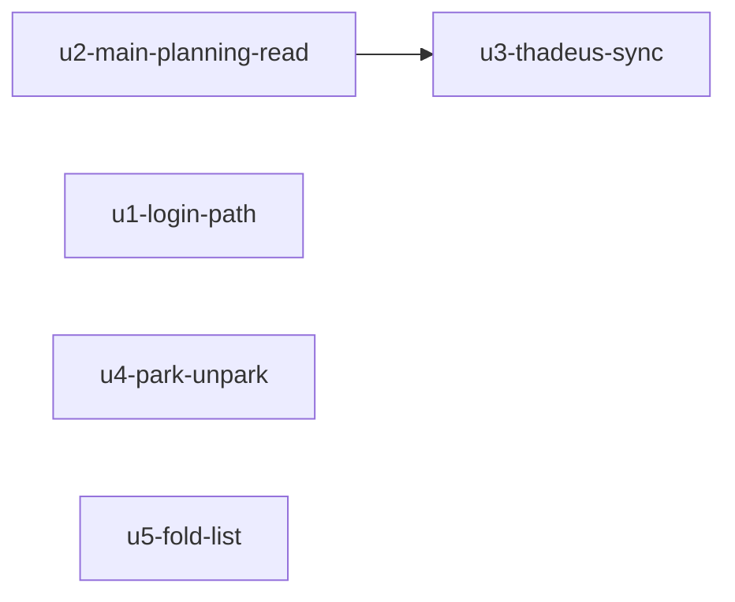

# Unit Dependencies: Release v0.2.13

## Dependency DAG

- **U3 u3-thadeus-sync depends on U2 u2-main-planning-read.** ThadeusSync uses PlanningSync's helpers and shares Planning Record's file (ADR-002), and the waiting count sits in the Releases view next to U2's source label. U2 changes PlanningSync's entry handling (the stale-entry drop), so U3's code and tests need U2's code to pass.
- U1, U2, U4 and U5 have no edges.



Text fallback: U3 needs U2. U1, U4 and U5 stand alone.

```yaml
units:
  - name: u1-login-path
    kind: library
    depends_on: []
  - name: u2-main-planning-read
    kind: library
    depends_on: []
  - name: u3-thadeus-sync
    kind: service
    depends_on: [u2-main-planning-read]
  - name: u4-park-unpark
    kind: ui
    depends_on: []
  - name: u5-fold-list
    kind: ui
    depends_on: []
```

## Integration points

| Between | What | How |
|---|---|---|
| U2 → U3 | Planning Record file, PlanningSync's worktree/rebase/push helpers, the per-root serial queue | shared code in main |
| U3, U2 → FeaturesView | source label and the combined waiting count | the existing `features:planningStatus` channel |
| U4 ↔ U1 | none: IntentPark uses ExecRunner's existing `runFixed` | — |
| U5 ↔ others | U5 adds a toggle to the views U2–U4 also touch; the files overlap, the code does not | `main` merged into the later branch and the suite rerun (project rule) |

## Parallel development

U1, U2, U4 and U5 can be built at the same time, each with only the project as it stands. U3 can start once U2 is in. Several topological orders are valid; Delivery Planning picks one.
